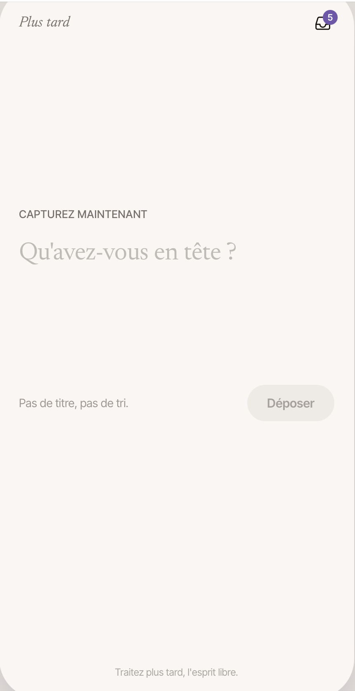
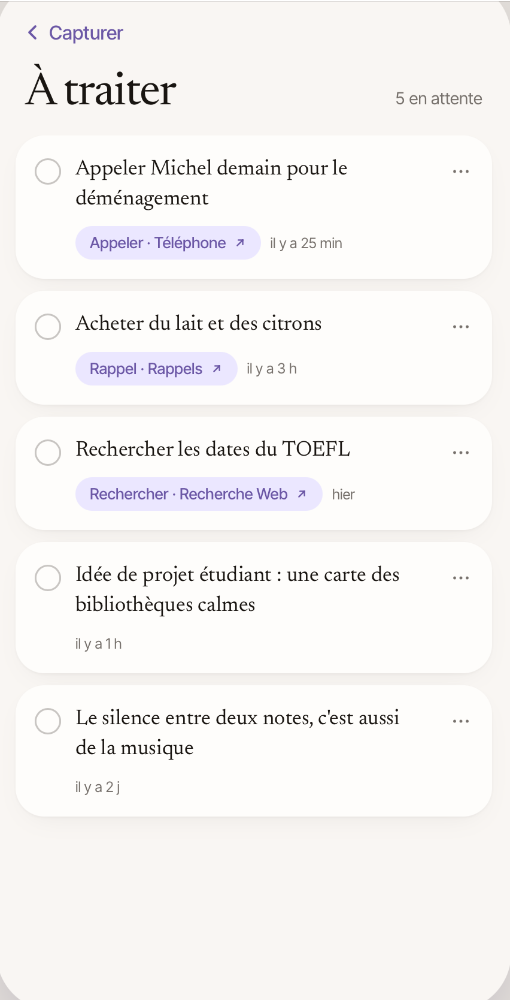

# Thought Inbox

**A calm place to drop a thought and come back to it later.**

Thought Inbox is a personal Flutter app for capturing a thought the moment it arrives, without a title, a category or a due date. The interface is in French. iOS is the first target. The project is in development, and no App Store release is planned yet.

## Visual reference

Two reference screens define the visual direction. They are design images, not yet reproduced in Flutter.

| Capture | To process |
| --- | --- |
|  |  |

The direction is a warm background, editorial serif typography, sans-serif metadata, rounded white cards and a violet accent. Exact fonts, sizes and colours are not yet confirmed.

## Current state (21 October 2026)

**Implemented in code**

- Multi-line capture with a "Déposer" action. Input is trimmed, and blank input is refused.
- Inbox sorted newest first, with archive and restore, and an Archives tab.
- Local JSON storage through `path_provider`, written to a temporary file and then renamed.
- Loading, empty and error states. A failed write keeps the typed text and shows a message.
- Model, storage, controller and widget tests.

**Not done yet**

- The two reference screens are not reproduced. The current UI is a single Material page with bottom tabs (Inbox / Archives).
- The circle action on each card, the menu, and the "Plus tard" signature are not implemented.
- The three suggestion chips (Phone, Reminders, Web search) appear only in the design reference. They are not integrations.
- The test suite was re-run on 22 October 2026 after the storage migration changes: 29 tests passed.
- Manual validation on an iOS simulator, including a full app restart, is pending.

**Out of scope for the MVP**

Accounts, backend, sync, AI, notifications, voice capture, editing, permanent deletion, search and third-party integrations.

## Data and privacy

Thoughts are stored only on the device, in an unencrypted JSON file. The app does not back them up, and deleting the app can delete them.

## Getting started

Requirements: a Flutter SDK compatible with the Dart constraint in `pubspec.yaml` (`^3.13.5`), Xcode and an iOS simulator.

```sh
git clone https://github.com/BertrandM78/thought-inbox.git
cd thought-inbox
flutter pub get
flutter devices
flutter run -d <simulator-id>
```

## Checks

```sh
dart format --output=none --set-exit-if-changed lib test
flutter analyze
flutter test
```

Visual changes also need a comparison with the reference screens on iOS at the same logical width, plus checks for the keyboard, small screens, large text and VoiceOver. See [docs/DESIGN.md](docs/DESIGN.md).

## Documentation

| File | Purpose |
| --- | --- |
| [PRODUCT.md](docs/PRODUCT.md) | Product intent, scope and status of each decision |
| [DESIGN.md](docs/DESIGN.md) | Visual contract, open states and validation steps |
| [ARCHITECTURE.md](docs/ARCHITECTURE.md) | Flutter structure, data compatibility and conventions |
| [ROADMAP.md](docs/ROADMAP.md) | Milestones M0 to M4, validation criteria and open decisions |
| [AUDIT.md](docs/AUDIT.md) | Inspection of the existing project and known gaps |
| [MILESTONE-1.md](docs/MILESTONE-1.md) | Record of the first functional milestone |
| [FIRST-PROMPT.md](docs/FIRST-PROMPT.md) | Starting prompt for the next milestone |
| [SECURITY-REVIEW.md](docs/SECURITY-REVIEW.md) | Pre-publication secret scan |
| [CLAUDE.md](CLAUDE.md) | Working rules for AI-assisted sessions |
